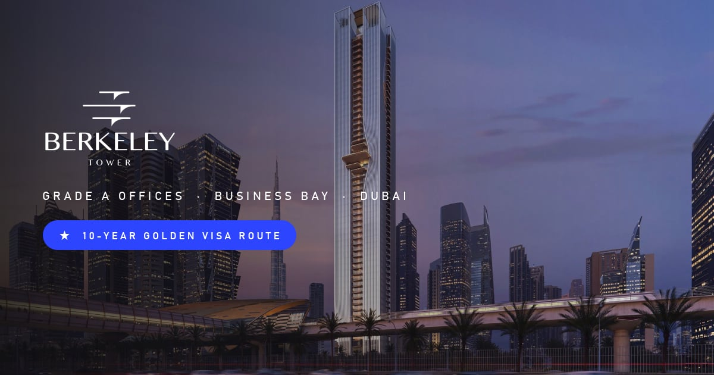
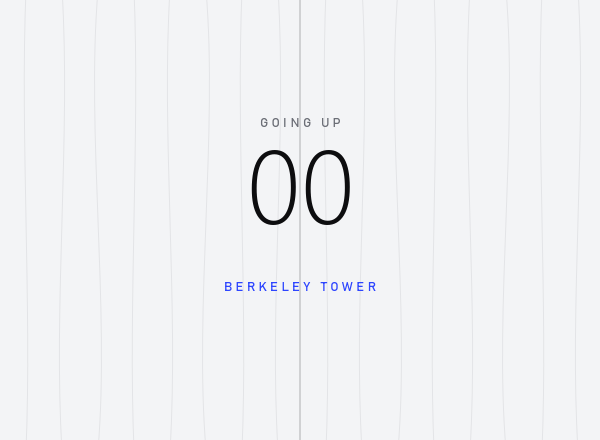
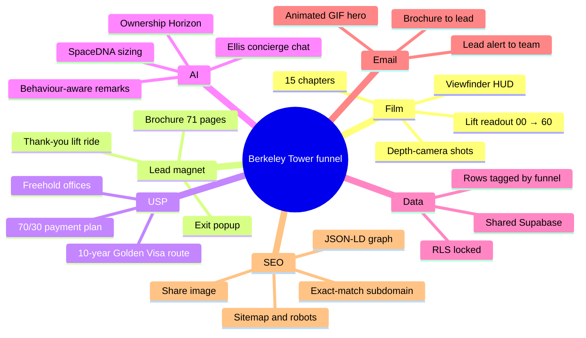
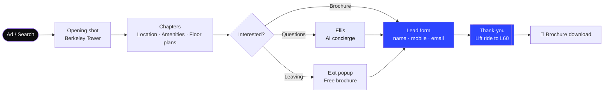
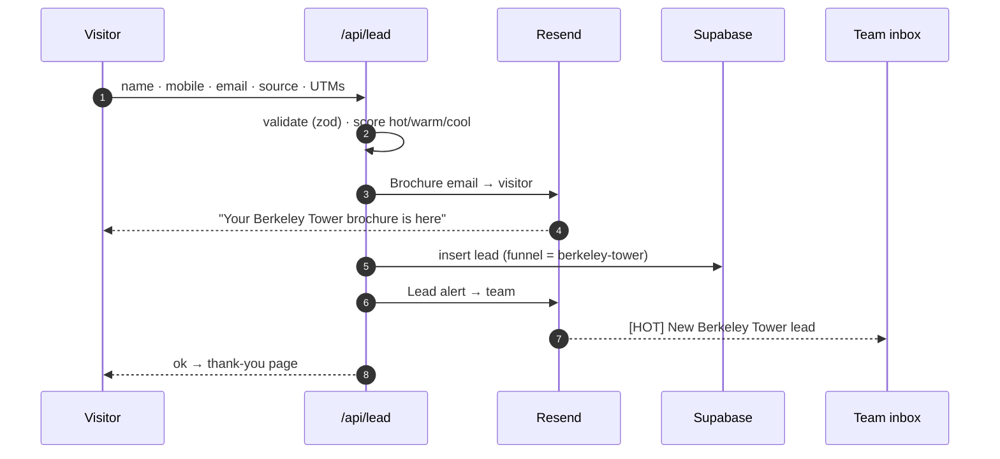
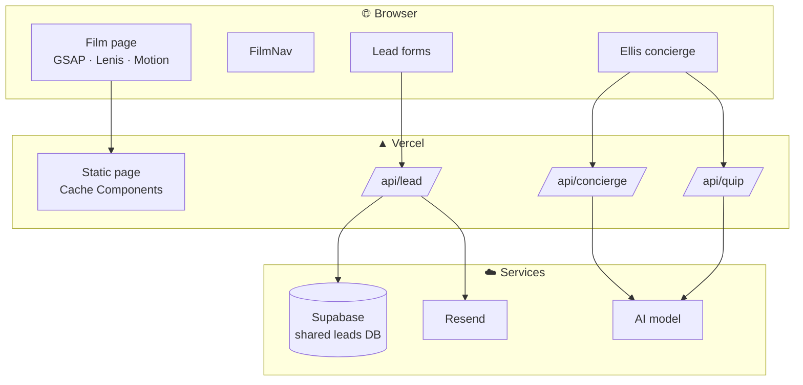
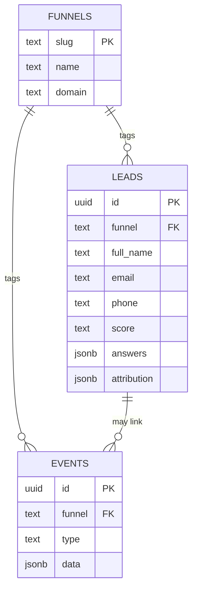
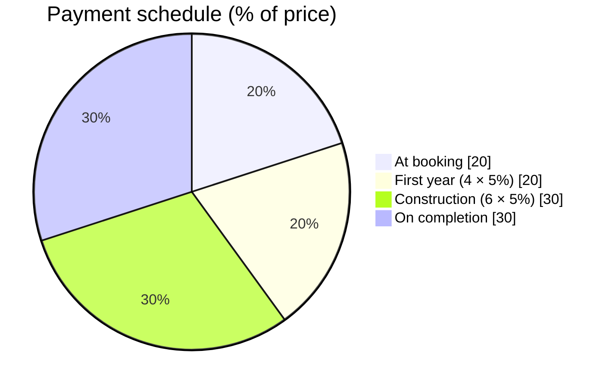

<div align="center">



# BERKELEY TOWER &nbsp;·&nbsp; BY ELLINGTON

**A cinematic, AI-powered launch funnel for Grade A offices on Sheikh Zayed Road, Business Bay.**
<br/>Presented by **Buildcaps Real Estate**.

[](https://berkeley-tower-by-ellington.buildcaps.com)


</div>

---

## 🎬 The idea

The site plays like a **film**. Full-screen depth-camera shots carry the visitor from street level to the crown, cut between clean white chapters. A lift readout tracks the floor you're on, and the thank-you page rides the lift to Level 60.

<div align="center">

<br/><sub><i>The lift ride, used as the animated hero in every lead email.</i></sub>
</div>

---

## 🧠 Mind map



---

## 🛗 The visitor's journey



---

## ⚡ What happens when a lead submits



---

## 🏗️ Architecture



---

## 🗄️ One database, every funnel



Each funnel gets its own view (`leads_berkeley_tower`, `leads_sobha_sanctuary`, …). Row-level security is on; only the server's secret key can read or write.

---

## 📊 Chapter map

| # | Chapter | Level | What it sells |
|:-:|---|:-:|---|
| 01 | Overview | G | 60 storeys · 109 freehold offices |
| 02 | Architecture | 05–60 | Louvered façade, fabric in motion |
| 03 | Location | 14 | 4 min to DIFC, Metro next door |
| 04 | Market | 24 | Business Bay #1 for office sales |
| 05 | Amenities | 32–35 | Co-working, clubhouse, wellness |
| 06 | Technology | 36 | 12 double-deck lifts |
| 07 | Floor plans | 41 | 1,132 sq ft → full floors |
| 08 | Summit | 54–58 | Duplex & triplex HQs |
| 09 | Future | 60 | Vertiport readiness |
| 10 | Payment plan | ★ | 70 / 30 |
| 11 | **Golden Visa** | ★ | **10-year residency route** |
| 12 | AI studio | ★ | SpaceDNA · Ownership Horizon |
| 13 | Developer | ★ | Ellington, design-led since 2014 |
| 14 | Questions | ★ | FAQ + consultant |
| 15 | Register | ★ | Brochure + launch access |

---

## 💰 70/30 payment plan



---

## 🎨 Design system

| Token | Colour | Use |
|---|---|---|
| `paper` |  | Base |
| `ink` |  | Type, dark chapters |
| `mist` |  | Panels, lift doors |
| `accent` |  | Electric cobalt |
| `whatsapp` |  | WhatsApp actions |

Type: **Archivo Expanded** for display, **Inter** for text. Signature: one square corner on every card.

---

## 🚀 Run it

```bash
pnpm install
cp .env.example .env.local   # fill in the keys
pnpm dev                     # http://localhost:3000
```

| Command | Does |
|---|---|
| `pnpm dev` | Dev server |
| `pnpm build` | Production build |
| `pnpm test` | 53 unit tests (Vitest) |
| `pnpm lint` | Biome |
| `node scripts/email-assets.mjs` | Rebuild email images, the lift GIF and the share image |

### Environment

| Variable | Purpose |
|---|---|
| `NEXT_PUBLIC_SITE_URL` | Canonical address |
| `SUPABASE_URL` · `SUPABASE_SECRET_KEY` · `FUNNEL_SLUG` | Shared leads database |
| `RESEND_API_KEY` · `EMAIL_FROM` · `LEAD_NOTIFY_TO` | Emails |
| `ANTHROPIC_API_KEY` | AI concierge and remarks (offline answers without it) |
| `NEXT_PUBLIC_GOOGLE_SITE_VERIFICATION` | Search Console |

---

## 📁 Structure

```
src/
├─ app/            page · API routes · robots · sitemap · share image
├─ components/
│  ├─ film/        shots, chapters, viewfinder
│  ├─ nav/         FilmNav, lift system, mobile bar
│  ├─ lead/        forms, popup, thank-you lift ride
│  ├─ concierge/   Ellis face, chat panel, remarks
│  └─ tools/       SpaceDNA, Ownership Horizon
├─ lib/
│  ├─ data/        tower facts, Golden Visa, broker, FAQ
│  ├─ email/       templates + Resend sender
│  └─ lead/        schema, delivery (Supabase · Resend)
supabase/migrations/   shared Buildcaps database
scripts/               asset pipelines
```

---

<div align="center">
<sub>Renders are illustrative. Prices, areas and dates are indicative until the Sales and Purchase Agreement. Golden Visa approval rests with ICP and the Dubai Land Department.</sub>
<br/><br/>
<b>Buildcaps Real Estate</b> · Conrad Office Tower, Office 1604, Sheikh Zayed Road, Dubai
</div>
